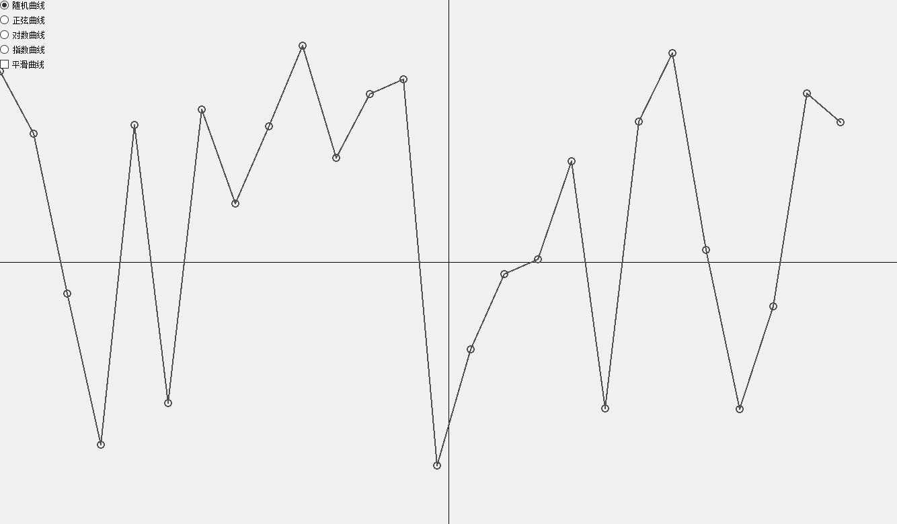
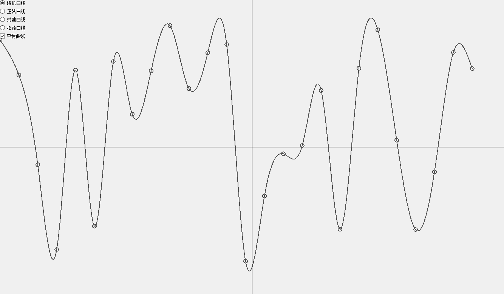
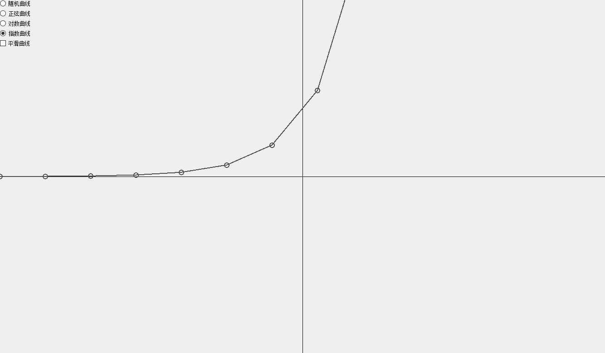
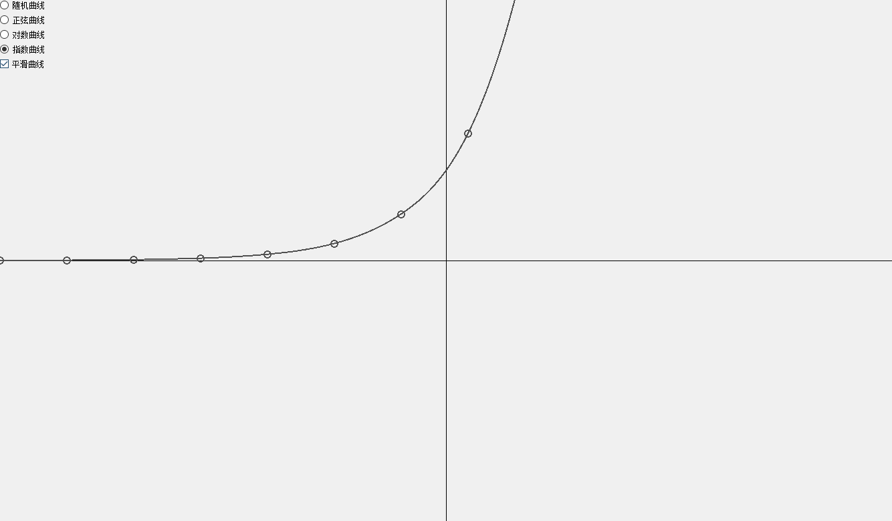

# Visual Demonstrations

## Overview
This guide provides visual demonstrations of the BezierCurve application's features and capabilities. Each curve type is shown both with and without smoothing to demonstrate the Bezier curve algorithm's effect.

## Random Curve Demonstration

*Random curve without smoothing - Points connected with straight lines*

*Random curve with smoothing - Points connected with smooth Bezier curves*

## Mathematical Function Curves

### Sine Wave

*Sine wave without smoothing - Original point connections*

*Sine wave with smoothing - Smooth Bezier curve interpolation*

## Interactive Features

### Curve Smoothing Process
1. Points are initially plotted on the coordinate system
2. Without smoothing: Points are connected with straight lines
3. With smoothing enabled: 
   - Control points are calculated
   - Cubic Bezier curves are generated
   - Smooth path is rendered

### Coordinate System
- The application window shows a centered coordinate system
- X-axis and Y-axis divide the window into quadrants
- Points are plotted relative to the origin (0,0)
- Grid lines help visualize point positions

### User Interface Elements
- Curve type buttons at the bottom
- Smoothing checkbox for toggling Bezier curves
- Real-time updates on parameter changes
- Window-responsive coordinate scaling

## Curve Type Comparisons

### Random Curve Characteristics
- Randomly distributed points
- Even x-axis spacing
- Variable y-coordinates
- Smooth transitions between points when enabled

### Sine Wave Features
- Periodic wave pattern
- Consistent amplitude
- Uniform frequency
- Smooth oscillation visualization

### Logarithmic Curve Properties
- Rapid initial growth
- Gradual leveling
- Natural log scaling
- Smooth growth visualization

### Exponential Curve Aspects
- Gradual initial growth
- Rapid value increase
- Exponential scaling
- Smooth acceleration visualization

## Implementation Details

### Bezier Curve Algorithm
The smoothing process:
1. Input: Set of control points
2. Process: 
   - Calculate control points
   - Generate cubic Bezier curves
   - Create continuous path
3. Output: Smooth curve through points

### Visual Improvements
- Consistent point size (10x10 pixels)
- Clear curve visibility
- Distinct before/after comparison
- Professional coordinate system display
